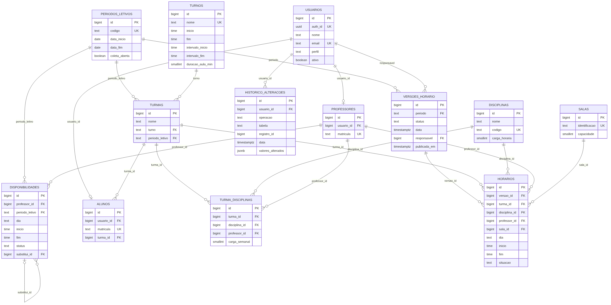

# Modelagem do banco de dados

SGBD: PostgreSQL (Supabase). Scripts em `sql/`:

| Arquivo | Conteúdo |
|---|---|
| `00_reset.sql` | Apaga as tabelas (apenas desenvolvimento). |
| `01_schema.sql` | Tabelas, chaves, restrições e índices. |
| `02_seed.sql` | Dados fictícios de teste. |
| `03_rls.sql` | Ativa Row Level Security em todas as tabelas. |

## DER

Código-fonte do diagrama: `der.mmd` (Mermaid).

## Tabelas

As 11 tabelas do enunciado foram mantidas. Foram acrescentadas duas tabelas de apoio (`turnos` e `periodos_letivos`) e alguns campos, todos necessários para as regras do enunciado.

| Tabela | Campos | Observações |
|---|---|---|
| `usuarios` | id, auth_id, nome, email, perfil, ativo, criado_em | `auth_id` liga ao Supabase Auth. `perfil` aceita aluno, professor ou coordenador. E-mail único e em minúsculas. |
| `professores` | id, usuario_id, matricula | `usuario_id` é único. |
| `alunos` | id, usuario_id, matricula, turma_id | |
| `disciplinas` | id, nome, codigo, carga_horaria | Carga horária total em horas. |
| `turmas` | id, nome, turno, periodo_letivo | `turno` e `periodo_letivo` são FKs para `turnos.nome` e `periodos_letivos.codigo`. |
| `salas` | id, identificacao, capacidade | |
| `turma_disciplinas` | id, turma_id, disciplina_id, professor_id, carga_semanal | Único por turma e disciplina. Carga semanal em aulas. |
| `disponibilidades` | id, professor_id, periodo_letivo, dia, inicio, fim, status, substitui_id, criado_em, atualizado_em | Status: aprovada, pendente, substituida, rejeitada. |
| `versoes_horario` | id, periodo, status, data, responsavel, publicada_em | Status: rascunho, em_revisao, publicada, arquivada. |
| `horarios` | id, versao_id, turma_id, disciplina_id, professor_id, sala_id, dia, inicio, fim, situacao | Situação: agendada, alterada, cancelada. |
| `historico_alteracoes` | id, usuario_id, operacao, tabela, registro_id, data, valores_alterados | `valores_alterados` é JSONB com antes e depois. |
| `turnos` (apoio) | id, nome, inicio, fim, intervalo_inicio, intervalo_fim, duracao_aula_min | Define a janela de aulas e o intervalo de cada turno. |
| `periodos_letivos` (apoio) | id, codigo, data_inicio, data_fim, coleta_aberta | `coleta_aberta` controla a edição direta de disponibilidade. |

## Integridade e segurança no banco

- Todas as chaves estrangeiras são declaradas. Remoções com vínculo são bloqueadas (`ON DELETE RESTRICT`), exceto onde o filho não faz sentido sem o pai (`turma_disciplinas`, `disponibilidades` e `horarios` por versão).
- Restrições CHECK validam perfil, dias, ordem de horários, status e intervalos de turno.
- `ux_versao_publicada`: índice único parcial que permite no máximo uma versão publicada por período.
- Restrições de exclusão (`btree_gist`) em `horarios` impedem sobreposição de professor, sala e turma na mesma versão. Funcionam como rede de segurança mesmo para edições manuais e para o algoritmo.
- RLS ativado em todas as tabelas, sem políticas. A API pública do Supabase (chave anon) não lê nem escreve nada. Apenas o backend, conectado como `postgres`, acessa os dados.

## Dados de teste

Atendem o cenário de validação: 3 turmas, 6 professores, 8 disciplinas e 5 salas, mais 9 alunos, 1 coordenador, 16 vínculos turma e disciplina e 22 disponibilidades.

- O professor Fábio Martins (P006) não tem disponibilidade, de propósito. No cenário de validação ele registra segunda e quarta, e só então suas aulas de API REST (turmas B e C) podem ser alocadas.
- A carga semanal de cada turma (16, 16 e 17 aulas) cabe nas 20 aulas semanais do turno.
- Contas de acesso: execute `npm run seed:auth` para criar os usuários no Supabase Auth (senha definida em `SEED_PASSWORD`).

| Perfil | E-mail |
|---|---|
| Coordenador | coordenacao@sucelso.tech |
| Professores | ana.souza, bruno.lima, carla.mendes, diego.rocha, elisa.prado, fabio.martins (todos `@sucelso.tech`) |
| Alunos | aluno.a1, a2, a3 (Turma A), b1 a b3 (Turma B), c1 a c3 (Turma C), `@sucelso.tech` |
